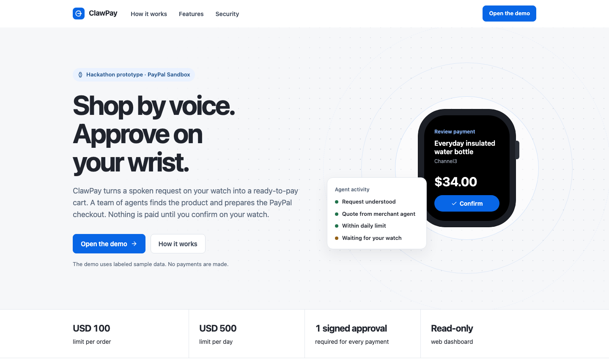
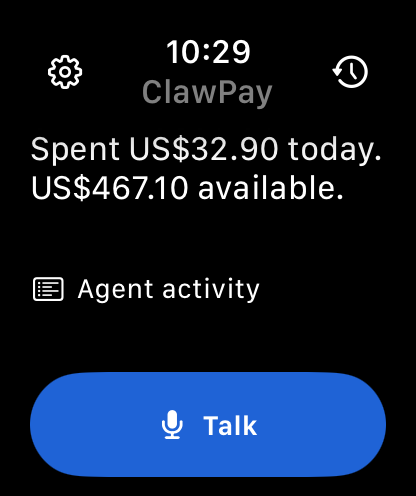
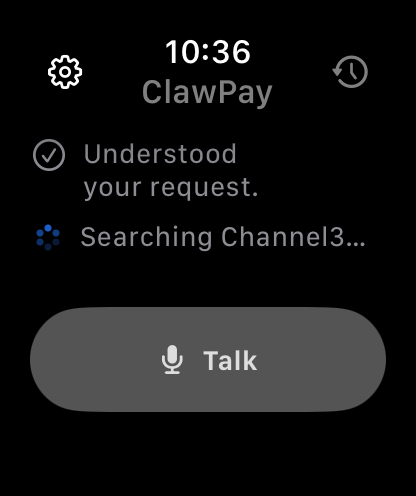
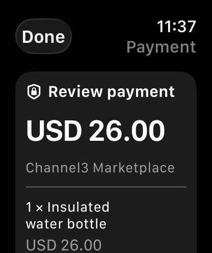
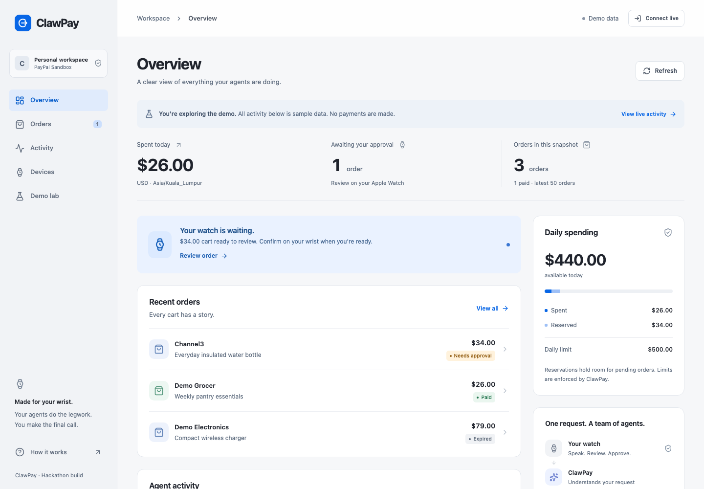
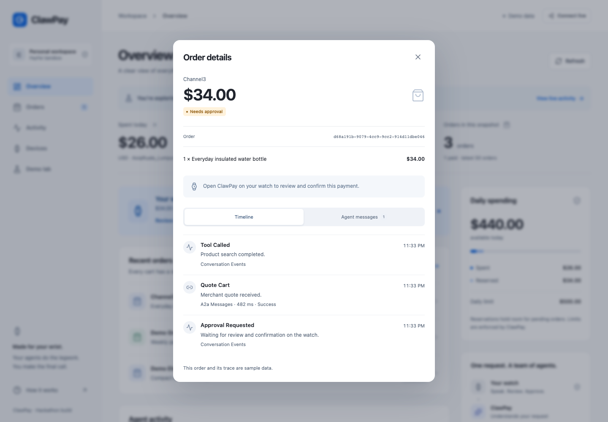
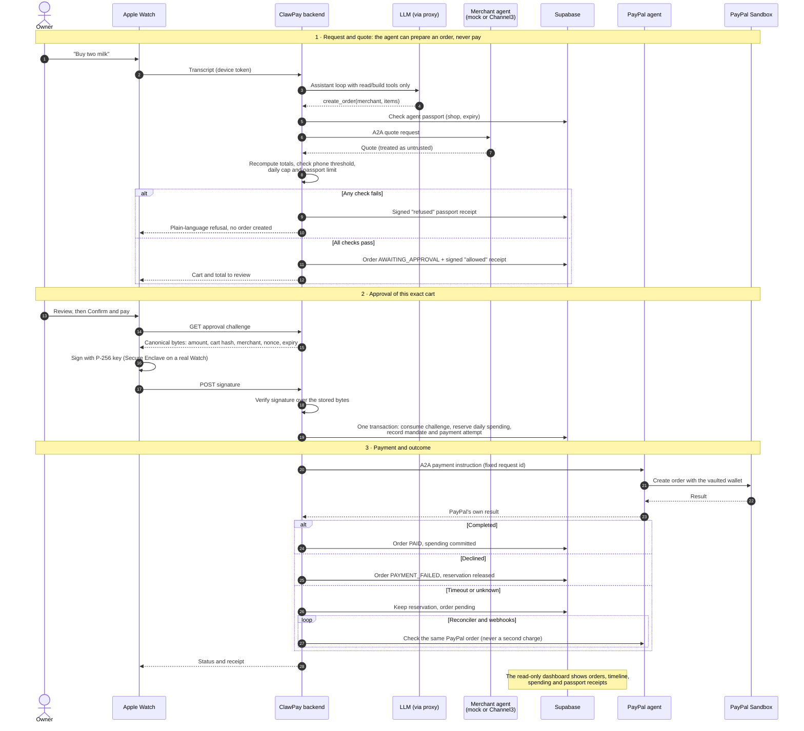

<div align="center">
  
  <h1>ClawPay</h1>
  <p><strong>Verified authorization for agent-led commerce.</strong></p>
  <p>Speak on your watch. Review the cart. Authorize the payment. Follow the outcome.</p>
  <p>
    <a href="https://clawpay.pages.dev/">Website</a> ·
    <a href="https://clawpay.pages.dev/dashboard">Try the dashboard</a> ·
    <a href="#run-locally">Run locally</a> ·
    <a href="docs/README.md">Documentation</a>
  </p>
</div>



## What we're building

ClawPay is a transaction authorization layer between an AI agent and a payment provider. The agent can find a product and prepare a cart; ClawPay checks its authority, requires approval of the exact transaction, and records the result. Our hackathon implementation brings that flow to Apple Watch, a separate PayPal agent, and a web dashboard.

The key question is **“Was this agent allowed to make this transaction, and what actually happened?”** ClawPay connects those two answers through:

- **Scoped agent passports.** Owners issue signed, revocable permissions with merchant restrictions, a per-order cap, and an expiry. The backend records allowed and refused decisions.
- **Approval tied to the cart.** A device signs an expiring challenge for the reviewed transaction. The agent cannot authorize payment by generating a “yes.”
- **Controlled payment execution.** A separate PayPal agent holds provider credentials. Spending reservations, idempotency, and reconciliation handle retries and uncertain outcomes.
- **An observable outcome.** Owners can inspect order status, sanitized agent handoffs, spending, and passport decisions in the dashboard.

ClawPay uses its own authorization format today. AP2 interoperability and production payment certification are not claimed.

## See the experience

### Voice and approval on Apple Watch

<table>
  <tr>
    <td align="center"></td>
    <td align="center"></td>
    <td align="center"></td>
  </tr>
  <tr>
    <td align="center">Speak a request</td>
    <td align="center">Follow agent activity</td>
    <td align="center">Review before paying</td>
  </tr>
</table>

Watch screenshots are simulator captures; the approval screen uses a visual fixture. Talk supports Fish Audio speech-to-text, automatic sending after a pause, and streamed speech replies. A Siri App Shortcut opens the same assistant flow; Siri cannot sign a payment. Physical-watch Siri and hardware presence checks need separate device validation.

### A dashboard for the owner—and the demo





Dashboard screenshots show labeled sample data from the public demo. The dashboard is read-only: payment approval stays on the device.

## Try it in a minute

Open **[the dashboard](https://clawpay.pages.dev/dashboard)**; the public demo needs no account.

1. Review an order to inspect its cart, timeline, and agent messages.
2. Open **Devices** to explore agent permissions and decision receipts.
3. Open **Demo lab** and replay **Voice to checkout**, **A budget that holds**, or **Resolve the unknown**.

These replays use sample data and do not execute payments. For the Watch-to-PayPal Sandbox flow, follow the [Watch guide](mobile/watch/README.md) and [deployment guide](deploy/README.md).

## How a transaction works



| Safeguard | Enforced by | Why the agent cannot bypass it |
| --- | --- | --- |
| Agent passport (shop, per-order cap, expiry) | Backend, before the merchant is called | The LLM never sees or edits the passport; it only gets a refusal |
| Prices and totals | Backend recomputation of the merchant quote | Prices are not tool arguments; tampered quotes are rejected |
| Approval of the exact cart | Device signature over server-built bytes | The signing key never leaves the device, and there is no "pay" tool |
| Daily spending cap | Locked database reservation at approval | Checked in the same transaction that consumes the approval |
| No double charge | One attempt per order, fixed PayPal request id, reconciliation | Retries and timeouts poll the same PayPal order instead of paying again |

The ESP-Claw device follows the same path, with a button hold instead of the Watch's Confirm and pay. On a physical Watch, approval uses a P-256 Secure Enclave key with device presence checks; the simulator uses a software key. Without a PayPal agent, the backend calls PayPal Sandbox directly with the same rules. Passport receipts are written only for devices that have a passport. Payment results come from provider responses and reconciliation, never from model prose.

### Current integration scope

| Component | What works today |
| --- | --- |
| Public website | Landing page and dashboard at `clawpay.pages.dev`; currently configured for demo mode |
| Shopping | Deterministic demo merchants; real Channel3 catalog search and price refresh when configured |
| Payments | PayPal **Sandbox** through the backend or a separate A2A PayPal agent |
| Delivery | A confirmed address and local delivery simulation on the Watch; no retailer purchase or carrier booking |
| Authorization | Project-specific signed approvals and agent passports; no full AP2 implementation |
| Hardware | Watch simulator demo and build instructions; ESP-Claw firmware lives outside this repo |

## Repository guide

```text
backend/         FastAPI, MCP tools, agents, payment orchestration, Supabase
frontend/        Vite + React SPA and read-only Hono API proxy
mobile/watch/    Native SwiftUI watchOS app and portable Swift checks
deploy/          VPS containers, private environment preparation, hosting guide
docs/            Product/design notes and README screenshots
```

| Start here | Guide |
| --- | --- |
| Backend, provider setup, and API | [Backend README](backend/README.md) |
| Dashboard development | [Frontend README](frontend/README.md) |
| Watch simulator, voice, and approval | [Watch README](mobile/watch/README.md) |
| Hosting and judge access | [Deployment guide](deploy/README.md) |
| API contracts and architecture | [Contracts](backend/docs/contracts.md) · [Architecture](backend/docs/architecture.md) |
| Checks and live validation still needed | [Verification](backend/docs/verification.md) · [Remaining work](backend/docs/remaining-work.md) |

## Run locally

### Dashboard demo

Use **Node 24+**. The sample dashboard runs without provider credentials or a backend:

```sh
cd frontend
npm ci
npm run build
npm start
```

Open [localhost:8787](http://127.0.0.1:8787/) for the landing page or [localhost:8787/dashboard](http://127.0.0.1:8787/dashboard) for the dashboard.

### Connected backend and Watch

Use **Python 3.12**, **uv**, a configured Supabase project, and PayPal Sandbox accounts. Start with the [backend setup guide](backend/README.md#setup-and-run), apply the incremental database migrations, and keep credentials in the ignored `backend/.env` file.

```sh
cd backend
uv sync --locked --python 3.12
cp -n .env.example .env
# Configure .env using the backend guide before starting.
uv run uvicorn app.main:app --host 127.0.0.1 --port 8000 --workers 1 --no-access-log
```

Copy the example only for a new setup; preserve an existing `.env`. Use one backend worker while rate limits and usage budgets are process-local. Live dashboard reads require the Supabase account that owns the paired Watch.

Open `mobile/watch/ClawPayWatch.xcodeproj` in Xcode and follow the [Watch simulator instructions](mobile/watch/README.md). No paid Apple Developer membership is needed for the simulator. The Watch uses the backend URL, not the Pages website URL.

### Verify a checkout

```sh
cd backend
uv run --offline pytest
```

```sh
cd frontend
npm test
npm run build:pages
# With npm start running and Playwright Chromium installed:
npm run test:ui
```

Automated provider tests use fakes. They do not prove a real PayPal transaction, hosted database isolation, or physical-watch behavior. See the [verification guide](backend/docs/verification.md) for those separate checks.

## License

[MIT](LICENSE) · Copyright © 2026 ClawPay contributors.
